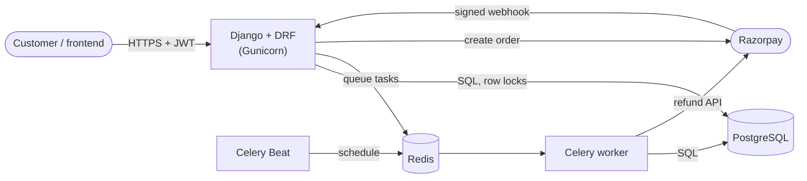

# SlotBook: a slot-booking backend that never double-books

A REST API for booking time slots (turf, gym, clinic, college rooms). The interesting part is
not the CRUD, it is the hard problems around it: **many people booking the same slot at the same
moment, people paying late, payment messages arriving twice, and money that must never get lost.**

> **Status:** 265 automated tests, 98% code coverage (90% minimum enforced), CI on every push.
> *(Re-run `pytest --cov` on your own machine and update these two numbers if they differ.)*

## What it does

- Register and log in with JWT. Browse open slots with filters, pagination and ordering.
- Book a slot: it is **held for 10 minutes** and disappears from the list for everybody else.
- Pay with Razorpay (test mode). The booking becomes CONFIRMED.
- Cancel a booking: if it was paid, the **refund starts automatically**.
- Unpaid holds expire by themselves (Celery Beat).

## The problems it solves

| Problem | How it is solved |
|---|---|
| 1000 users click "Book" on one slot together | The slot row is locked inside a transaction (`SELECT ... FOR UPDATE`). One wins, the rest get a clean `409`. A conditional unique constraint in PostgreSQL is the safety net. |
| Prove it, do not just claim it | A 50-thread test that fails with the naive code (and shows real double booking when the database rule is removed) and passes with the lock. A live demo: `python manage.py race_demo`. |
| User pays, then closes the tab | Razorpay's signed **webhook** confirms the booking, even if the browser never calls back. |
| Razorpay sends the same webhook twice | The event id is stored with a UNIQUE constraint in the same transaction as the work. The second copy is ignored. |
| Payment arrives after the 10-minute hold ended | The slot is locked again. Free: the booking is confirmed. Taken by someone else: the money is refunded. Never a double booking, never lost money. |
| Our server crashes while handling a webhook | Everything rolls back, we answer 500, Razorpay retries, and the retry is processed. |
| Password guessing and flooding | Rate limiting per IP and per user. A broken Redis never takes the API down (fails open). |

## Architecture



More diagrams (booking states, the race, the payment flow) are in [docs/ARCHITECTURE.md](docs/ARCHITECTURE.md).

## Tech stack

| Area | Tools |
|---|---|
| API | Python 3.12, Django 5.2, Django REST Framework, SimpleJWT, django-filter, drf-spectacular (Swagger) |
| Data | PostgreSQL (row locks, constraints, partial unique index), Redis |
| Background jobs | Celery worker + Celery Beat |
| Payments | Razorpay (test mode): orders, signature verification, webhooks, refunds |
| Quality | pytest, pytest-django, factory_boy, coverage (90% minimum), ruff, bandit, pip-audit |
| Delivery | Docker, Docker Compose, Gunicorn, WhiteNoise, GitHub Actions |

## Run it

**With Docker (everything in one command):**

```bash
cp .env.docker.example .env.docker      # then edit the secrets
docker compose up --build
```

Open http://localhost:8000/api/docs/ (Swagger) and http://localhost:8000/api/health/.

**Without Docker:** create a virtual environment, `pip install -r requirements.txt -r requirements-dev.txt`,
copy `.env.example` to `.env`, start PostgreSQL and Redis, then:

```bash
python manage.py migrate
python manage.py seed_demo
python manage.py runserver
celery -A config worker -l info          # second terminal  (Windows: add --pool=solo)
celery -A config beat -l info            # third terminal
```

See the double-booking protection live:

```bash
python manage.py race_demo --users 30
```

Full deployment steps: [docs/DEPLOY.md](docs/DEPLOY.md).

## API overview

| What | Endpoint |
|---|---|
| Register, log in, refresh, who am I | `POST /api/auth/register/`, `/login/`, `/refresh/`, `GET /api/auth/me/` |
| Venues and open slots | `GET /api/venues/`, `GET /api/slots/?city=&date=&min_price=&max_price=&ordering=` |
| Book, list mine, cancel | `POST /api/bookings/`, `GET /api/bookings/me/`, `POST /api/bookings/<id>/cancel/` |
| Pay | `POST /api/payments/create-order/`, `POST /api/payments/verify/` |
| Razorpay calls us | `POST /api/payments/webhook/` |
| Health check, docs | `GET /api/health/`, `GET /api/docs/` |

## Tests and quality

```bash
pytest --cov                 # all tests + coverage report (fails below 90%)
ruff check .                 # lint
bandit -r bookings payments users venues config -x "*/tests/*,*/tests.py,*/migrations/*"
```

- Unit and API tests for every service, view and task.
- **Concurrency tests** with real threads and real database transactions (50 users, one slot).
- **Webhook tests**: bad signatures, duplicates, crash and retry, late payments.
- An **end-to-end test** of the whole customer journey.
- The Razorpay library runs against a **fake Razorpay server**, so no network is needed.
- GitHub Actions runs lint, security scans, migrations check, tests with coverage, and a Docker build on every push.

## Project layout

```
config/      settings (all via environment variables), URLs, Celery, rate limiting
users/       custom user, register / login / refresh / me
venues/      Venue, Slot, slot search and filters
bookings/    Booking model + rules, the locking service, Celery expiry task, race_demo
payments/    Payment, WebhookEvent, Razorpay service, webhook, refunds
tests/       pytest-style tests, factories
docs/        architecture, deployment, learning notes
docker/      entrypoint script (web / worker / beat / all)
```

## Limits (honest list)

- Venue owners manage venues and slots in the Django admin. There is no owner-facing API yet.
- Refund policy is "always the full amount".
- Razorpay is used in test mode only.
- No frontend. The API and Swagger are the interface.
